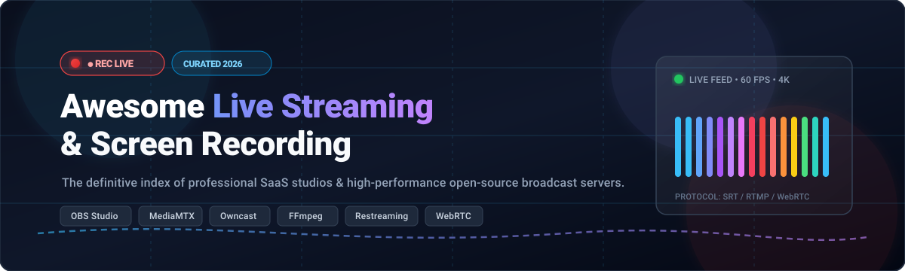

  

  
  
  
  
  

---

# 📡 Awesome Live Streaming & Recording

> 🎥 A curated index of top SaaS live production platforms, cloud restreaming services, and self-hosted open-source streaming servers, video encoders, and screen recorders.

Whether you are a gaming creator streaming to Twitch and YouTube, a broadcast engineer routing multi-camera RTMP/SRT/WebRTC feeds, or a software developer architecting decentralized video pipelines, this repository catalogs the premier solutions across the live media landscape.

---

## 📑 Table of Contents

- [📊 Sector Overview & Market Dynamics](#-sector-overview--market-dynamics)
- [☁️ SaaS & Hosted Platforms](#-saas--hosted-platforms)
- [💻 Open-Source GitHub Projects](#-open-source-github-projects)
- [📈 Star History](#-star-history)
- [🤝 How to Contribute](#-how-to-contribute)
- [💖 Support](#-support)
- [⚠️ Disclaimer](#-disclaimer)

---

## 📊 Sector Overview & Market Dynamics

The global video and live streaming software market is estimated at **$14B to $18.6B (2024–2026)**, expanding at a CAGR of ~15% fueled by real-time interactive engagement, cloud broadcasting, and enterprise video adoption. The sector exhibits a **hybrid market structure**: highly concentrated at the underlying cloud infrastructure/CDN layer (dominated by hyperscalers like AWS CloudFront/IVS, Microsoft Azure, and Akamai), yet **moderately-to-highly fragmented** across the application and tooling tiers, where specialized creator studios, multi-destination restreamers, enterprise white-label platforms, and vibrant open-source ecosystems (like OBS and MediaMTX) continuously compete without a single winner-take-all monopoly.

---

## ☁️ SaaS & Hosted Platforms

The following table benchmarks category-leading hosted live streaming studios, multistreaming aggregators, and professional broadcast suites. Entries are sorted descending by company scale (valuation or annual revenue).

| Platform 🏷️ | Scale (Valuation / Revenue) 🏢 | Starting Pricing Tier 💳 | Free Tier / Free Trial Limits ⏱️ | Highlights & Capabilities 🚀 |
|:---|:---|:---|:---|:---|
| **[Vimeo Livestream](https://vimeo.com/)** | **~$1.3B Valuation** (~$417M ARR, acquired by Bending Spoons) | **$12/month** (Starter, billed annually) / Live streaming unlocks on **Advanced at $75/seat/month** | **Free for life plan**: 3 GB total storage limit, standard video sharing/creation tools with Vimeo watermark; live streaming requires paid subscription or 30-day trial of paid plans | Enterprise video cloud with simulcasting, automated closed captioning, browser-based studio production, and integrated CRM/OTT tools. |
| **[StreamYard](https://streamyard.com/)** | **$250M Valuation** (Acquired by Hopin / Bending Spoons; ~$30M ARR) | **$35.99/month** (Core plan, billed annually at $431.88/yr) | **Free for life plan**: Max 6 on-screen participants, 2 hours/month local recording, stream displays permanent StreamYard watermark, single-platform destination | Zero-download browser studio for multi-guest remote interviews, live overlays, audience comment broadcasting, and multistreaming. |
| **[Telestream Wirecast](https://www.telestream.net/wirecast/)** | **~$100M–$250M Est. Revenue** (Genstar Capital portfolio) | **$42/month** (Studio, billed annually at $499/yr) or $799 lifetime license | **Free trial**: Fully functional trial with no day cap, but applies an audible periodic tone and permanent video watermark on all outputs | Industry-standard desktop production software supporting unlimited live camera inputs, NDI, PTZ control, multi-track audio, and ISO recording. |
| **[Streamlabs](https://streamlabs.com/)** | **$118M Acquisition Valuation** (Subsidiary of Logitech International) | **$15.75/month** (Ultra, billed annually at $189/year) or $27/month | **Free for life plan**: Permanent Starter tier with Streamlabs Desktop, 1 horizontal + 1 vertical stream output, basic Cloudbot moderation, 1 GB cloud storage, 0% tip fee | Comprehensive creator broadcasting suite built on OBS, packed with overlays, tipping systems, app store integrations, and multi-platform streaming. |
| **[Restream.io](https://restream.io/)** | **$50M+ Valuation** (~$15M–$25M ARR; backed by Insight Partners) | **$16/month** (Standard, billed annually at $190/year) or $19/month | **Free for life plan**: Simultaneous streaming to up to 2 channels, 720p Restream Studio resolution, Restream watermark displayed on stream, no custom RTMP | Cloud multistreaming switchboard pushing feeds to 30+ destinations simultaneously with centralized cross-platform chat and browser studio. |
| **[BoxCast](https://www.boxcast.com/)** | **~$20M+ Raised** (~$7M–$11M ARR) | **$109/month** (Standard plan, billed annually) | **14-day free trial**: Full software platform access with up to 1080p streaming and analytics; no permanent free plan | Hardware and cloud broadcast ecosystem popular with houses of worship, municipalities, and athletics, featuring automated scheduling and smart CDNs. |
| **[vMix](https://www.vmix.com/)** | **~$5M–$10M Est. Revenue** (StudioCoast Pty Ltd, Bootstrapped) | **$60 one-time** (Basic HD) / **$50/month** (vMix MAX) up to $1,200 Pro | **60-day free trial**: 100% unrestricted access to vMix Pro (all features, 4K, no watermarks, unlimited inputs, vMix Call) | Ultra-optimized Windows video switcher and live production software capable of instant replay, NDI, virtual sets, and low-latency hardware acceleration. |
| **[Dacast](https://www.dacast.com/)** | **~$9.4M Est. Revenue** (Privately held) | **$39/month** (Starter, billed annually with 2.4 TB bandwidth/yr) | **14-day free trial**: 10 GB bandwidth allowance and full access to test live streaming, video hosting, and paywall features; no permanent free plan | Enterprise white-label video platform featuring Akamai CDN delivery, pay-per-view monetization, custom player branding, and live recording. |
| **[Lightstream](https://golightstream.com/)** | **~$5M–$8M Est. Revenue** (Acquired by Xsolla; $10M raised historically) | **$9/month** (Gamer, billed annually at $108/yr) or $12/month | **Free for life plan**: 720p output, up to 3 scenes, max 10 hours per stream session, displays Lightstream logo watermark | Cloud-based live production tool allowing Xbox, PlayStation, and mobile gamers to add overlays, alerts, and scenes without capture cards. |

---

## 💻 Open-Source GitHub Projects

Explore battle-tested open-source streaming software, real-time media ingestion servers, restreaming proxies, and screen capture applications. Ranked descending by GitHub stargazers.

| Project & Repo 📦 | GitHub_Stars ⭐ | Description 📝 | Primary Use Case 🛠️ |
|:---|:---:|:---|:---|
| **[OBS Studio](https://github.com/obsproject/obs-studio)** |  | The definitive free and open-source software for live streaming and recording across Windows, macOS, and Linux. Unlimited scenes, VST filters, and rich plugin ecosystem. | Desktop Live Production & Recording |
| **[FFmpeg](https://github.com/FFmpeg/FFmpeg)** |  | The universal multimedia powerhouse framework. Provides low-level encoding, transcoding, muxing, streaming, filter pipelines, and hardware-accelerated video rendering. | Media Transcoding & Protocol Muxing |
| **[ShareX](https://github.com/ShareX/ShareX)** |  | Fast, lightweight Windows screen capture, screen video recording, file sharing, and productivity tool with seamless integration to 80+ cloud destinations. | Screen Recording & Desktop Capture |
| **[SRS (Simple Realtime Server)](https://github.com/ossrs/srs)** |  | High-performance, production-grade video streaming cluster supporting RTMP, WebRTC, HLS, HTTP-FLV, SRT, and AI real-time audio/video processing integrations. | Real-Time Media Server & Transmuxing |
| **[LiveKit](https://github.com/livekit/livekit)** |  | End-to-end, ultra-low latency WebRTC stack and media server for live interactive audio/video conferencing, streaming, and multi-modal AI agents. | WebRTC Real-Time Broadcasting |
| **[MediaMTX](https://github.com/bluenviron/mediamtx)** |  | Zero-dependency, single-binary live media routing server and proxy for publishing, reading, and recording live streams across SRT, WebRTC, RTSP, RTMP, and LL-HLS. | Media Routing & Protocol Gateway |
| **[Kap](https://github.com/wulkano/Kap)** |  | Elegant, minimal open-source screen recorder engineered on web technology and Electron for macOS. Export captures easily to GIF, MP4, WebM, and APNG. | macOS Screen Capture & GIF Maker |
| **[PeerTube](https://github.com/Chocobozzz/PeerTube)** |  | ActivityPub-federated decentralized video sharing and live streaming platform utilizing browser P2P (BitTorrent) to dramatically minimize server egress bandwidth. | Decentralized Federated Streaming |
| **[nginx-rtmp-module](https://github.com/arut/nginx-rtmp-module)** |  | Canonical NGINX extension module for live stream publishing via RTMP, multi-bitrate HLS/DASH generation, video-on-demand streaming, and stream relaying. | RTMP Ingestion & HLS Packaging |
| **[Owncast](https://github.com/owncast/owncast)** |  | Independent, self-hosted live video and interactive chat server. Works with any RTMP client (OBS, Wirecast). Single Go binary with custom web viewer and emojis. | Self-Hosted Creator Live Streaming |
| **[datarhei Restreamer](https://github.com/datarhei/restreamer)** |  | Self-hosted complete streaming server solution with an intuitive web GUI. Restreams HLS, RTMP, and SRT to YouTube, Twitch, Facebook, and custom websites. | Docker Restreaming & Web Player |
| **[Ant Media Server](https://github.com/ant-media/Ant-Media-Server)** |  | Ultra-low latency video streaming engine providing sub-0.5s WebRTC streaming, adaptive bitrate streaming, RTSP IP camera ingestion, and cloud clustering. | Sub-Second Scalable Live Streaming |
| **[Stream-rec](https://github.com/stream-rec/stream-rec)** |  | Automated multi-platform live stream recording tool with bullet comments (danmaku) recording, webhook notifications, and automated upload triggers. | Automated Stream & Danmaku Capture |
| **[OWT Server](https://github.com/open-webrtc-toolkit/owt-server)** |  | Open WebRTC Toolkit server providing robust real-time communication, media analytics, hardware-accelerated transcoding, and multi-party video conferencing. | Enterprise WebRTC Media Processing |
| **[OpenStudio](https://github.com/msitarzewski/openstudio)** |  | Browser-native multi-host podcast and live broadcast studio with hybrid peer-to-peer WebRTC media routing, mix-minus audio, and Icecast broadcast distribution. | WebRTC Multi-Guest Live Studio |
| **[Muxshed / Shed](https://github.com/muxshed/shed)** |  | Self-hosted multistreaming engine and production studio. Ingest one feed and relay simultaneously to multiple targets with scheduled broadcasts and WebRTC links. | Self-Hosted Studio & Restreamer |
| **[Lembang-Opcast](https://github.com/JiilanTj/Lembang-Opcast)** |  | Lightweight Linux-native screen recording and live streaming application using X11 screen capture, PulseAudio, and hardware-accelerated FFmpeg RTMP output. | Lightweight Linux Screen Recorder |

---

## 📈 Star History

---

## 🤝 How to Contribute

Contributions are warmly welcome! Help expand and update this resource:

1. 🍴 **Fork the repository**.
2. 🌿 **Create a descriptive feature branch** (`git checkout -b add-streaming-tool`).
3. 📝 **Add/edit entries in `README.md`** following the existing tabular structure, including verified pricing tiers, exact trial limits, and official GitHub Stars_Badges.
4. 🚀 **Submit a Pull Request** with a concise summary of the changes.

---

## 💖 Support

If you find this list helpful for discovering streaming and recording software, please consider showing your support:

- ⭐ **Star this repository** to help others discover it!
- 🍴 **Fork and share** with your fellow broadcasters, developers, and content creators.
- ☕ **Buy me a coffee**: Support ongoing curation and open-source maintenance via the [GitHub Sponsors Dashboard](https://github.com/sponsors/ishandutta2007).

---

## ⚠️ Disclaimer

- This is a **community-curated** resource and does not constitute an endorsement of any listed service or software.
- High-bitrate live streaming and recording demand adequate upstream bandwidth, dedicated hardware encoders (NVENC/QuickSync/AMF), and proper firewall/NAT configuration for RTMP, SRT, and WebRTC ports.
- Always review third-party platform terms of service when multistreaming to providers such as YouTube, Twitch, Kick, and Facebook Live.
